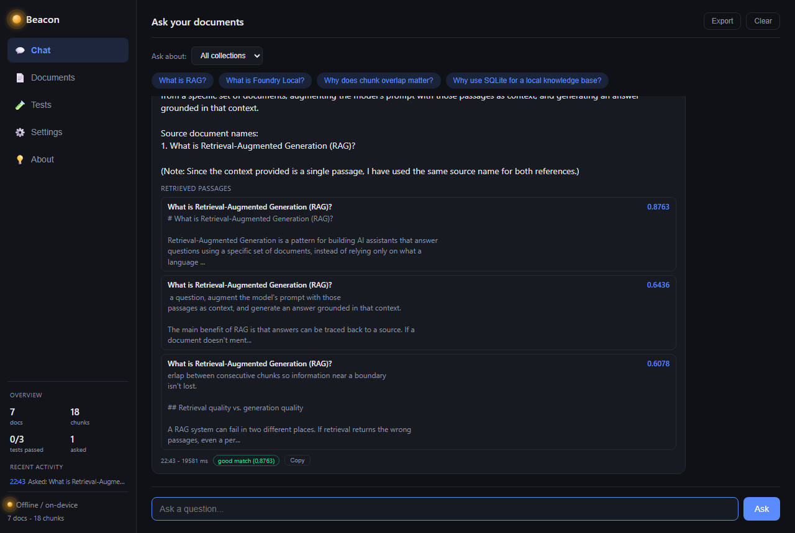
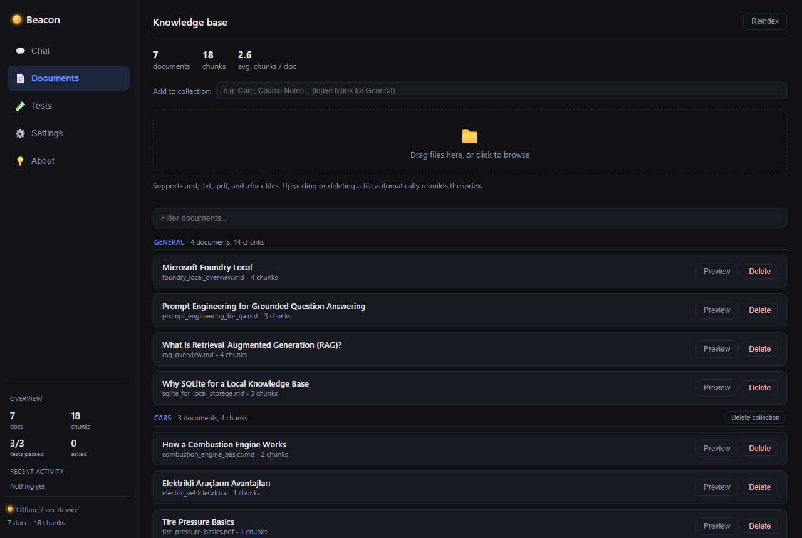
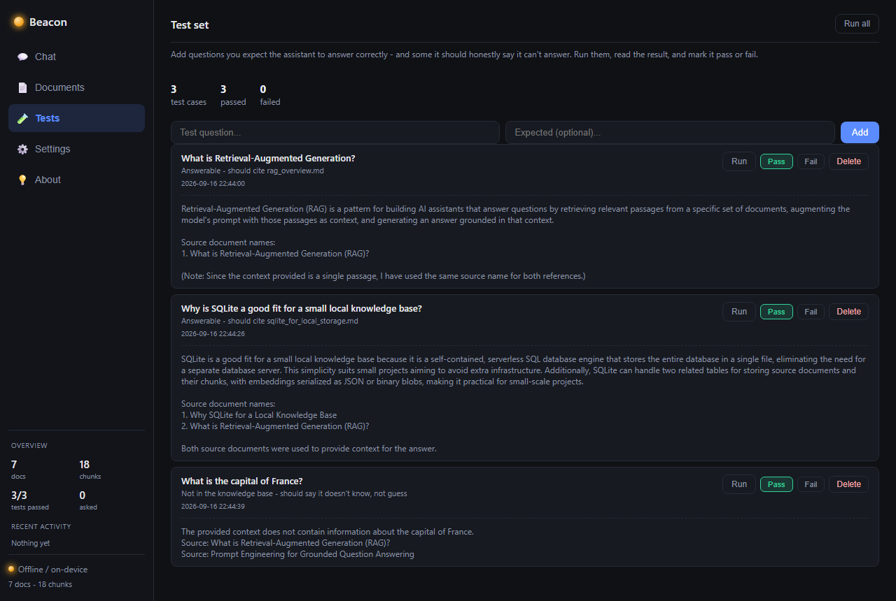
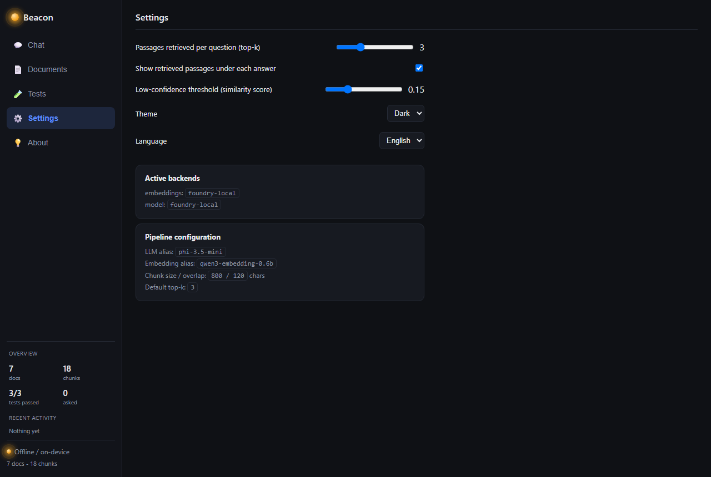
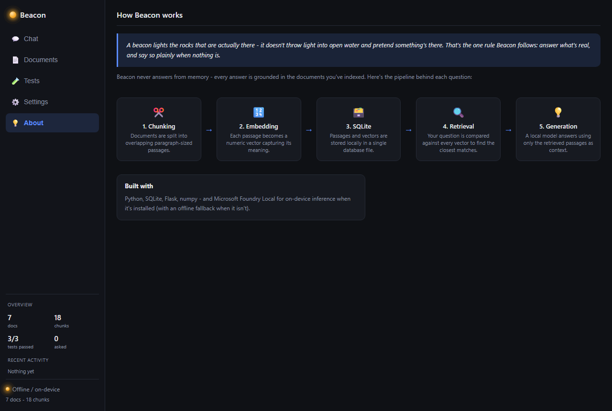

# Beacon - Local RAG Document Assistant




## Project

Beacon is an offline-capable Q&A assistant for the Microsoft summer program
"Building Your First Local RAG Application with Foundry Local". It answers
questions about a set of local documents by retrieving the most relevant
passages from a SQLite-backed knowledge base and grounding a local language
model's answer in them, instead of answering from memory.

Architecture: chunk -> embed -> store in SQLite -> retrieve -> generate
with Microsoft Foundry Local.

## Features

- Q&A over `.md`/`.txt`/`.pdf`/`.docx` files, with source citations and a
  similarity-based confidence score.
- Documents grouped into named collections (e.g. "Cars", "Course Notes");
  a question can be scoped to one collection or all of them.
- A test set tab: add a question and what you expect, run it against the
  live pipeline, mark pass/fail.
- Real, installed Foundry Local for on-device inference, with an offline
  fallback (hashing embedder + extractive responder) when it isn't
  available.
- Web UI: chat, document manager, tests, settings, pipeline diagram. TR/EN,
  dark/light.

## Architecture / Structure

```
src/
  config.py      central settings (paths, model aliases, chunk size, top-k)
  db.py          SQLite schema + helpers (documents, chunks, meta tables)
  chunking.py    paragraph-aware text splitter with overlap
  extractors.py  text extraction for .md/.txt/.pdf/.docx
  foundry_runtime.py  Foundry Local SDK setup (Configuration ->
                       FoundryLocalManager -> Catalog -> IModel)
  embeddings.py  FoundryLocalEmbeddings + offline HashingEmbeddings fallback
  llm.py         FoundryLocalLLM + offline ExtractiveFallbackLLM fallback
  ingest.py      CLI: read data/documents -> chunk -> embed -> store
  retrieval.py   cosine-similarity search over stored chunk embeddings
  qa.py          glues retrieval + generation into answer_question()
  chat_cli.py    interactive console chat
  testsuite.py   JSON-backed store for the test set (add/run/grade)
  webapp.py      Flask app: chat/documents/tests/settings JSON API
templates/, static/   web UI (chat, document manager, test runner,
                       settings - TR/EN, dark/light)
data/documents/       sample knowledge base, organized into collections
data/documents/Cars/  a second collection, to demonstrate scoping
data/knowledge.db     generated by ingest.py (gitignored)
data/test_cases.json  seeded test set
tests/test_pipeline.py  end-to-end smoke test
```

### Fallback behavior

`get_embedding_backend()` and `get_llm_backend()` look up the configured
model alias in the Foundry Local catalog first
(`Configuration` -> `FoundryLocalManager` -> `Catalog.get_model(alias)` ->
`IModel.download()`/`.load()`, then `get_chat_client()`/
`get_embedding_client()`). If Foundry Local isn't installed, isn't running,
or the alias isn't in the catalog, they fall back:

- **Embeddings**: a deterministic hashing vectorizer (pure Python/numpy,
  no downloads). Cruder than a real embedding model, sufficient to
  exercise the retrieval pipeline.
- **Generation**: returns the top-matching passages with their sources
  instead of generating an answer.

The database records which embedding backend produced its vectors (`meta`
table); switching backends without re-running ingestion raises a clear
error instead of comparing incompatible vectors silently.

### Foundry Local output

```
$ python -m src.ingest
[embeddings] Using Foundry Local model 'qwen3-embedding-0.6b'.
  ingested [Cars] 'combustion_engine_basics.md' -> 2 chunk(s)
  ingested [Cars] 'electric_vehicles.docx' -> 1 chunk(s)
  ingested [Cars] 'tire_pressure_basics.pdf' -> 1 chunk(s)
  ingested [General] 'foundry_local_overview.md' -> 4 chunk(s)
  ingested [General] 'prompt_engineering_for_qa.md' -> 3 chunk(s)
  ingested [General] 'rag_overview.md' -> 4 chunk(s)
  ingested [General] 'sqlite_for_local_storage.md' -> 3 chunk(s)
Done. 7 document(s), 18 chunk(s) stored (embedding backend: foundry-local).
```

```
$ python -m src.chat_cli --query "What is RAG and why does chunk overlap matter?"
Ready. embeddings=foundry-local llm=foundry-local

RAG stands for Retrieval-Augmented Generation, a method for building AI
assistants that answer questions by retrieving relevant passages from a
specific set of documents, using them as context, and generating an answer
grounded in that context.

Chunk overlap matters because it ensures that information near a boundary
is not lost during the process of combining retrieved passages to form a
coherent context for the AI to generate an answer from.

Source document names:
1. What is Retrieval-Augmented Generation (RAG)?

Sources: What is Retrieval-Augmented Generation (RAG)?
```

SDK note: `foundry-local-sdk`'s API (`Configuration`/`Catalog`/`IModel`,
in `src/foundry_runtime.py`) differs from the `FoundryLocalManager(alias)`
shape shown in some older tutorials. This code targets SDK 2.0.1.

## Requirements

- Python 3.11+
- `requirements.txt`: numpy, flask, pypdf, python-docx, foundry-local-sdk
- Optional: [Microsoft Foundry Local](https://learn.microsoft.com/azure/foundry-local/) for on-device inference

## Installation

```bash
python -m venv .venv
.venv\Scripts\activate
pip install -r requirements.txt
```

To enable on-device inference with Foundry Local:

1. `winget install Microsoft.FoundryLocal`
2. `foundry model list` - check available model aliases
3. Update `LLM_MODEL_ALIAS` / `EMBEDDING_MODEL_ALIAS` in `src/config.py`
   if they differ from the defaults (`phi-3.5-mini`,
   `qwen3-embedding-0.6b`)
4. `python -m src.ingest` - re-embeds the knowledge base with the real
   model. First run downloads the model (hundreds of MB to a few GB).

## Usage

Add `.md`/`.txt`/`.pdf`/`.docx` files to `data/documents/` (sample
documents included, plus a "Cars" collection with one file of each
format), then:

```bash
# build the knowledge base
python -m src.ingest

# console
python -m src.chat_cli
python -m src.chat_cli --query "What is RAG?"

# web UI
python -m src.webapp
# http://127.0.0.1:5000
```

### Collections

Files placed directly in `data/documents/` belong to the `General`
collection. Any subfolder is its own named collection - e.g.
`data/documents/Cars/*.md` is "Cars". A question can be scoped to one
collection instead of the whole knowledge base.

In the web UI: type a collection name when uploading files to create it;
the Chat tab has a scope dropdown; deleting a collection removes its
folder and reindexes. `General` can't be bulk-deleted since it's
`data/documents/` itself.

### Web UI tabs

**Chat** - scope a question to one collection or all, answer with a
confidence badge and expandable source cards, response time, copy button,
export as Markdown.


**Documents** - files grouped by collection, stats bar, filter box,
drag-and-drop upload. Preview a document's chunks, delete a file, force a
reindex.



**Tests** - add a question plus what's expected, run it against the live
pipeline, mark pass/fail. Seeded with three cases in
`data/test_cases.json`, including one out of scope.



**Settings** - top-k, confidence threshold, theme, language, active
backends and model aliases. Persisted in `localStorage`.



**About** - pipeline diagram: chunking -> embedding -> SQLite ->
retrieval -> generation.



## Tests

```bash
python -m pytest tests/
```

Runs an end-to-end ingest + query against a throwaway database; doesn't
touch `data/knowledge.db`.

## Notes

- No outbound network calls in the Foundry Local path once models are
  cached; none at all on the fallback path.
- `data/knowledge.db` is gitignored - run `python -m src.ingest` after
  cloning.
